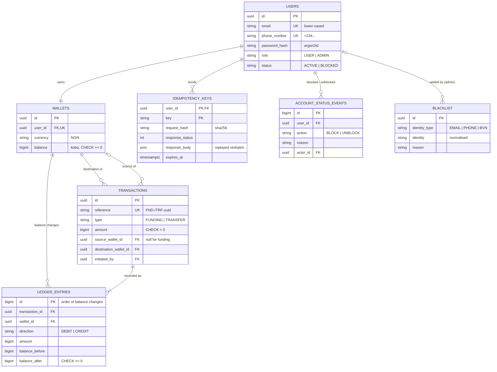

# Lendsqr Wallet Service

A wallet service with user accounts, wallets and wallet-to-wallet transfers. It is built to
keep balances exact under parallel requests, to never move money twice for a duplicated or
replayed request, and to be secure by default.

**Live:** https://lendsqr-wallet-rjgm.onrender.com (opens the Swagger docs) ·
[Demo client](https://lendsqr-wallet-rjgm.onrender.com/app/) ·
[Health](https://lendsqr-wallet-rjgm.onrender.com/health)

**Stack:** Node.js 22 · TypeScript · NestJS 11 · PostgreSQL · Knex · Jest · Render.
Optional demo client: Next.js 16 (static export) served by the API at `/app`.

> Render free tier: after ~15 minutes idle, the first request can take ~50s while the
> service wakes up.

## At a glance

| Guarantee | How | Proof |
|---|---|---|
| **Balances stay exact under concurrency** | Every money movement runs in one DB transaction that locks the wallet rows (`FOR UPDATE`), in wallet-id order | 50 parallel ₦10 transfers from a ₦100 wallet → exactly 10 succeed, 40 refused, balance never below 0. Run against the **live deployment** as well as in the e2e suite |
| **No duplicate or replayed transactions** | Required `Idempotency-Key`, claimed in the same DB transaction as the money movement | The same transfer fired 10× at once moves money once and returns 10 byte-identical responses |
| **Secure by default** | Every route needs a JWT unless explicitly public; strict validation; blocked accounts cut off immediately; blacklist (local + Lendsqr Adjutor Karma) at signup | 41 unit + 118 e2e API tests, 56 client unit tests, plus a 33-step Postman walkthrough |

Every funding and transfer test ends by checking the ledger: each balance equals its credits
minus debits, every entry's arithmetic holds, and the total of all balances equals the total
ever funded (money is conserved).

## Review in 5 minutes

**Option A: run everything (recommended).** Import
[`postman/lendsqr-wallet.postman_collection.json`](postman/lendsqr-wallet.postman_collection.json)
into Postman. It already points at the live service. On the collection's **Variables** tab
set `demoPassword` and `adminPassword` (sent with the submission), then click **Run
collection**. That's 33 requests in seven steps, each with an automatic check, and every
request's **Docs** tab explains what it demonstrates.

**Option B: click through Swagger** at https://lendsqr-wallet-rjgm.onrender.com:

1. `POST /auth/login` as `ada@demo.wallet` → copy `accessToken` → **Authorize**.
2. `POST /wallets/fund` with an `Idempotency-Key` of your own (any new value, e.g. a UUID)
   and `{ "amount": 250000 }` (₦2,500; amounts are in kobo).
3. Send **exactly the same request again**: same response, header `Idempotent-Replayed: true`,
   and the balance only went up once.
4. `POST /transfers` with a new key and
   `{ "recipientEmail": "tunde@demo.wallet", "amount": 150000 }`.
5. `GET /transactions`: your statement, each line with `direction` and `balanceAfter`.
6. Try `POST /transfers` with an amount larger than your balance → `422 Insufficient funds`.

**Option C: use the demo client** at https://lendsqr-wallet-rjgm.onrender.com/app/. Sign in as
Ada to add money, send money to `tunde@demo.wallet` and read the statement; sign in as the
admin to block/unblock users and manage the blacklist. It's a thin client over the same API
(see [Demo client](#demo-client-app)).

| Seeded account | Role | Opening balance |
|---|---|---|
| `admin@demo.wallet` | ADMIN | – |
| `ada@demo.wallet` | USER | ₦10,000.00 |
| `tunde@demo.wallet` | USER | ₦5,000.00 |

## The brief, mapped

| Requirement | Where | Tested in |
|---|---|---|
| Create user accounts and their wallets | User and wallet are created in **one transaction**: [`auth.service.ts`](src/modules/auth/auth.service.ts) | [`auth.e2e-spec.ts`](test/auth.e2e-spec.ts) |
| Transfers between wallets | [`transfers.service.ts`](src/modules/transfers/transfers.service.ts) | [`transfers.e2e-spec.ts`](test/transfers.e2e-spec.ts) |
| Check users against a blacklist | Local list + Adjutor Karma: [`blacklist.service.ts`](src/modules/blacklist/blacklist.service.ts), [`karma.client.ts`](src/modules/blacklist/karma.client.ts); admin-managed via `/admin/blacklist` | [`karma.client.spec.ts`](src/modules/blacklist/karma.client.spec.ts), [`blacklist.service.spec.ts`](src/modules/blacklist/blacklist.service.spec.ts), [`admin-blacklist.e2e-spec.ts`](test/admin-blacklist.e2e-spec.ts) |
| Block / unblock accounts | Audited, race-safe status changes: [`admin-users.service.ts`](src/modules/users/admin-users.service.ts) | [`admin-users.e2e-spec.ts`](test/admin-users.e2e-spec.ts) |
| Concurrency: accurate balances under parallel requests | Ordered row locks: [`wallets.repository.ts`](src/modules/wallets/wallets.repository.ts) | `concurrency` blocks in [`transfers.e2e-spec.ts`](test/transfers.e2e-spec.ts) and [`wallets.e2e-spec.ts`](test/wallets.e2e-spec.ts) |
| Protection against duplicate or replayed transactions | [`idempotency.service.ts`](src/modules/idempotency/idempotency.service.ts) | `idempotency` blocks in the same files |
| Secure by default | Global auth and role guards: [`jwt-auth.guard.ts`](src/common/auth/jwt-auth.guard.ts); validation and headers: [`app.setup.ts`](src/app.setup.ts); env validated at boot: [`env.validation.ts`](src/config/env.validation.ts) | Throughout |
| Node.js + TypeScript, NestJS, SQL | NestJS 11, PostgreSQL via Knex migrations: [`migrations/`](src/database/migrations) | – |
| Hosted on Render | [`render.yaml`](render.yaml) Blueprint: web service + Postgres | Live URL above |

## Data model



## Design decisions

### Money and the ledger
- **Integer minor units (kobo)** in `BIGINT` columns; no floating point anywhere. The API
  only accepts JSON integers (`"100"`, `10.5`, `0` and negatives are rejected), with a
  per-transaction cap (`MAX_TRANSACTION_AMOUNT`, default ₦5,000,000).
- **Double-entry ledger:** every balance change writes a ledger entry with
  `balance_before` / `balance_after`; a transfer writes a DEBIT and a CREDIT.
- **Database constraints are the last line of defence**, even if application code were
  wrong: `CHECK (balance >= 0)`, positive amounts, no self-transfers, unique references.

### Concurrency
Every money-moving request runs this inside **one database transaction**:

```
1. claim the Idempotency-Key      INSERT INTO idempotency_keys (user, key, request hash)
2. lock the wallet(s)             SELECT ... ORDER BY wallet id FOR UPDATE OF wallets, FOR SHARE OF users
3. check status, limits, balance  (under the locks: these are the values that count)
4. update balance(s)
5. write transaction + ledger entries
6. store the response on the key
COMMIT
```

- **`FOR UPDATE` on the wallet** makes concurrent changes queue instead of overwriting each
  other. With the lock removed, the 25-parallel-fundings test loses about 90% of the
  updates, which shows the test really exercises the race.
- **Locks are taken in wallet-id order in one query**, so A→B and B→A at the same moment
  can't deadlock (tested: 40 opposite-direction transfers, all succeed).
- **`FOR SHARE` on the owner's user row** means a block waits for in-flight transfers, and
  nothing that starts after a block commits can move money.
- No distributed locks, queues or caches: Postgres row locks and constraints do the work.

### Duplicate and replay protection
`POST /wallets/fund` and `POST /transfers` **require** an `Idempotency-Key` header.

| Situation | Result |
|---|---|
| New key | Executes, `201` |
| Same key + same payload (retry, double-click, replay) | Original response replayed **byte-for-byte** with `Idempotent-Replayed: true`; no money moves |
| Same key, fired concurrently | Postgres makes duplicates wait on the first insert, then they replay its result |
| Same key + different payload, or a different endpoint | `422`: a key belongs to exactly one operation |
| The request failed (insufficient funds, blocked...) | The claim rolls back too, so the client can retry with the same key |
| Key older than `IDEMPOTENCY_TTL_HOURS` (24h) | Treated as new |

- Claiming the key **in the same transaction** as the work means there is no window where
  money has moved but the key isn't recorded, or the reverse.
- Keys are **scoped per user**. The fingerprint is a SHA-256 of the operation plus the
  validated payload as canonical JSON, so field order doesn't matter but any value change
  does.
- Stored responses use Postgres `json`, not `jsonb` (which reorders keys), so replays are
  exact.

### Onboarding and the blacklist
- Signup checks, in order: validation (`400`) → duplicate email/phone (`409`) → **local
  blacklist** → **Lendsqr Adjutor Karma** for email and phone (`403` on a match) → create user
  and wallet in one transaction.
- **Why both lists:** Karma is the ecosystem-wide record of defaulters and fraud that a
  lender shouldn't skip; the local list lets the operator act on its own intelligence
  immediately.
- **A Karma record only counts if its `karma_identity` matches what we asked about.**
  Test-mode Adjutor apps return the same mock record for every lookup, and that must never
  block a real customer.
- **Fail closed:** if Karma times out (3s), errors or is rate-limited, signup is refused with
  `503`, including on the hosted demo. For a lender, onboarding an unchecked identity is
  worse than asking someone to retry. `KARMA_FAIL_OPEN=true` flips this.
- **Karma calls are spent carefully:** they're rate-limited (9/min in test mode, two per
  signup) and billed per call in live mode, so invalid and duplicate signups are rejected
  before Karma is called.
- **To see a refusal:** as admin, `POST /admin/blacklist`
  `{ "identityType": "EMAIL", "identity": "someone@example.com", "reason": "demo" }`, then
  register with that email → `403`.
- **Identities are normalised** (lower-cased emails; Nigerian phones in any common format
  become `+234…`), so uniqueness and blacklist matching can't be bypassed by reformatting.
- The blacklist gates **signup**; existing accounts are restricted with an explicit,
  audited **block**.

### Blocking accounts
- `PATCH /admin/users/:id/block` and `/unblock` require a `reason` and write an audit event
  with the acting admin, in the same transaction as the status change. Repeating the
  current state is `409`; admins can't block themselves.
- A block takes effect **immediately and everywhere**: login refused, existing tokens
  rejected (the auth guard re-reads the user on every request), no sending or funding
  (`403`), no receiving (`422`).

### Authentication and security
- **Secure by default:** a global JWT guard (routes opt out with `@Public()`) and a role
  guard; helmet headers; rate limiting (10/min per IP on auth routes); strict DTO validation
  that rejects unknown fields (e.g. `"role": "ADMIN"` at signup); environment validated at
  boot; one error shape `{ statusCode, error, message, requestId }` with no stack traces.
- Passwords hashed with **argon2id**. Login gives the same `401` for an unknown email and a
  wrong password, and takes the same time for both, so emails can't be enumerated.
- Users only ever see their own data: someone else's transaction reference gets the same
  `404` as a missing one, and a transfer response never reveals the recipient's balance.

### Transaction history
`GET /transactions` is built from the **ledger**: one line per entry on your wallet, so each
line shows your side (`direction`, `balanceAfter`), like a bank statement. Lines are ordered
by ledger sequence, not timestamp. Postgres `now()` is a transaction's *start* time, and
a transfer that waited on a lock is applied after ones that started later. This was found by
a race test against the live deployment and is covered by a regression test.

> Funding is simulated: in production the credit would come from a payment provider's
> verified webhook, using the provider's reference as the idempotency key.

## API reference

All routes are under `/api/v1` and need `Authorization: Bearer <token>` unless marked
public. Full request/response details are in Swagger and in each Postman request's Docs.

| Method | Path | Auth | Description |
|---|---|---|---|
| POST | `/auth/register` | public | Blacklist check, then create the user and NGN wallet; returns a token |
| POST | `/auth/login` | public | Email + password → bearer token (1h) |
| GET | `/users/me` | user | Profile and wallet |
| GET | `/wallets/me` | user | Wallet and balance |
| POST | `/wallets/fund` | user | Credit your wallet (simulated deposit). **`Idempotency-Key` required** |
| POST | `/transfers` | user | Send to `recipientWalletId` or `recipientEmail`. **`Idempotency-Key` required** |
| GET | `/transactions?page=&limit=` | user | Your statement, newest first |
| GET | `/transactions/:reference` | user | One of your transactions |
| GET | `/admin/users?page=&limit=&email=` | admin | List users |
| GET | `/admin/users/:id` | admin | User, wallet and block/unblock history |
| PATCH | `/admin/users/:id/block` · `/unblock` | admin | Block / restore an account (`reason` required) |
| POST | `/admin/blacklist` | admin | Blacklist an email, phone or BVN (`reason` required) |
| GET | `/admin/blacklist?page=&limit=` | admin | List entries |
| DELETE | `/admin/blacklist/:id` | admin | Remove an entry |
| GET | `/health` | public | Liveness and DB check (no `/api/v1` prefix) |
| GET | `/app/` | public | The demo client (static files; no `/api/v1` prefix) |

## Running locally

Requires Node 22+ and Docker (Postgres runs in a container; it isn't used in deployment).

```bash
cp .env.example .env
npm install
npm run db:up        # Postgres in Docker (also creates the wallet_test database)
npm run migrate      # apply schema
npm run seed         # demo admin + two funded users (idempotent)
npm run start:dev    # http://localhost:3000 → Swagger
```

Optional: `npm --prefix web install && npm run build:web` before starting the API serves the
demo client at http://localhost:3000/app/.

```bash
npm test             # 41 unit tests
npm run test:e2e     # 118 end-to-end tests against the wallet_test database
npx newman run postman/lendsqr-wallet.postman_collection.json --env-var baseUrl=http://localhost:3000 --env-var demoPassword=... --env-var adminPassword=...
```

Set `ADJUTOR_API_KEY` in `.env` to enable Karma; without it only the local blacklist
applies. Karma allows 9 lookups per minute in test mode, so leave a minute between full
Postman runs.

| Script | Purpose |
|---|---|
| `migrate` / `migrate:rollback` / `migrate:status` | Schema migrations, run from compiled `dist/` so local and Render record identical migration names |
| `seed` | Idempotent demo data |
| `migrate:prod`, `seed:prod`, `start:prod` | Used by Render on boot |

## Deployment

[`render.yaml`](render.yaml) is a Render Blueprint: one Node web service plus a managed
Postgres database. Render builds the API and the demo client from this repository, and on
boot runs migrations, the idempotent seed, then the app. `JWT_SECRET` is generated by Render; `ADJUTOR_API_KEY`,
`SEED_ADMIN_PASSWORD` and `SEED_DEMO_PASSWORD` are set in the dashboard. The health check is
`/health`.

## Demo client (`/app`)

The API is the deliverable; the client in [`web/`](web) is an optional, thin way to see it
work. It's deliberately small: Next.js 16 + React 19 + TypeScript, no UI kit, state library or
router beyond Next's own.

- **One deployment, one origin.** Next.js exports static files (`output: 'export'`), and the
  API serves them at `/app` ([`app.setup.ts`](src/app.setup.ts)). No second service, no CORS,
  no extra cold start.
- **Strict Content-Security-Policy without `'unsafe-inline'`.** The export contains small
  inline scripts, so a post-build step ([`csp-hashes.mjs`](web/scripts/csp-hashes.mjs)) hashes
  each one and the API allows exactly those hashes on `/app`. API routes keep Helmet's
  default policy.
- **Duplicate protection from the user's side.** Each money form picks its `Idempotency-Key`
  when you submit: an identical retry (timeout, failure, double click) reuses the key, so the
  server replays instead of moving money again; editing the amount or recipient gets a new
  key ([`idempotency.ts`](web/src/lib/idempotency.ts)). Tested in a browser by dropping a
  successful transfer's response and retrying: money moved once.
- **No floating-point money.** Typed amounts are parsed as text into integer kobo
  (`"19.99"` → `1999`, not `1998.999…`) and formatted back without division artefacts
  ([`money.ts`](web/src/lib/money.ts)).
- **Sessions.** The token lives in `sessionStorage` (survives a refresh, not closing the tab).
  A `401`, or a block, signs you out with an explanation. An HttpOnly cookie would be
  stronger but needs CSRF protection on the API; left out of scope.
- **Static-export fix.** Next writes nested route prefetch files as
  `wallet/__next.wallet/__PAGE__.txt` but requests `wallet/__next.wallet.__PAGE__.txt`;
  [`flatten-prefetch.mjs`](web/scripts/flatten-prefetch.mjs) writes both names so a plain
  static server doesn't answer 404.

**Developing the client:**

```bash
npm --prefix web install
npm run build:web    # export to web/out, then restart the API: it reads the CSP hashes at boot
npm run dev:web      # or: hot-reloading dev server on :3001, calling the API on :3000
npm --prefix web test
```

`npm run dev:web` points at `http://localhost:3000/api/v1` via `web/.env.development`; if your
API runs on another port, override `NEXT_PUBLIC_API_BASE` in `web/.env.development.local`.

## What I'd do with more time

Deliberately left out to keep the scope to the brief:

- **Password change and reset:** an authenticated change-password endpoint, and "forgot
  password" via emailed single-use, expiring tokens. Today a password is set at signup.
- **Refresh tokens** with rotation and reuse detection; access tokens currently last 1 hour.
- **Idempotency-key cleanup:** expired keys are handled correctly but never purged; a
  scheduled job would.
- **Real funding** through a payment provider's verified webhooks instead of the simulated
  deposit.
